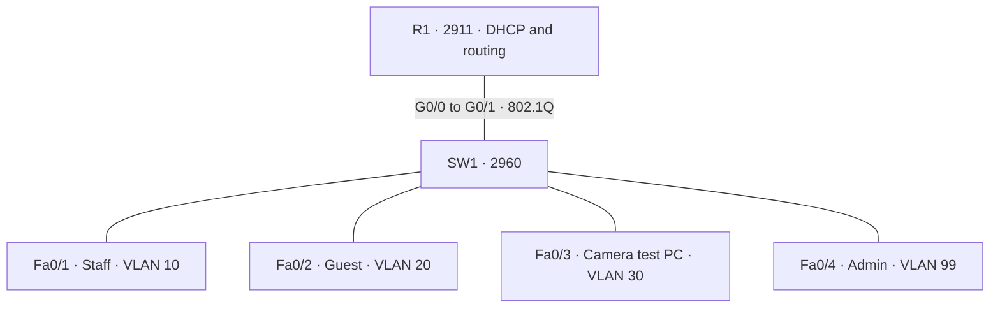

# Network Troubleshooting Casebook

A networking portfolio by **Alhussin Abutalib**.

## Overview
An educational hotel network investigation kit for Cisco Packet Tracer. It connects network design with the incident workflow used in IT Support: identify symptoms, collect evidence, test a hypothesis, restore service, and document the outcome.

## Status and results
The baseline configurations, three incident runbooks, topology, verification matrix, and Git publishing guide are prepared with AI assistance. **Packet Tracer execution is pending.** No operational success, resolution time, or screenshot evidence is claimed.

| Milestone | Status |
|---|---|
| Repository and implementation guide | Prepared |
| Baseline simulation | Pending |
| INC-001 wrong access VLAN | Pending execution |
| INC-002 missing trunk VLAN | Pending execution |
| INC-003 wrong default gateway | Pending execution |
| Before/after screenshots and .pkt files | Pending capture |

## Requirements
Cisco Packet Tracer supporting Cisco 2911 and Catalyst 2960 models, Git, and basic IPv4, VLAN, and DHCP knowledge. The .cfg files contain CLI commands to paste into a fresh simulation; review model-specific interface names before use.

## Topology

See [diagram source](diagrams/topology.mmd).

| VLAN | Purpose | Subnet | Gateway | Endpoint |
|---|---|---|---|---|
| 10 | Staff | 10.10.10.0/24 | 10.10.10.1 | DHCP |
| 20 | Guests | 10.10.20.0/24 | 10.10.20.1 | DHCP |
| 30 | Camera test | 10.10.30.0/24 | 10.10.30.1 | 10.10.30.10 |
| 99 | Management | 10.10.99.0/24 | 10.10.99.1 | Admin 10.10.99.10, switch 10.10.99.2 |
| 999 | Unused/native | None | None | Unused ports shut down |

## Implementation
1. Follow [setup](docs/setup.md) to wire the devices.
2. Apply [router commands](configs/baseline/router.cfg) and [switch commands](configs/baseline/switch.cfg).
3. Configure DHCP on Staff and Guest PCs. Configure static addressing on Camera and Admin PCs using the table.
4. Run the [baseline checks](docs/verification.md). Record actual results.
5. Save labs/baseline.pkt only after validating the baseline.
6. Make a separate baseline copy for each incident, introduce one fault, and follow its runbook.
7. Capture sanitized before/after evidence and update the incident record.
8. Publish using [the Git guide](docs/git-workflow.md).

## Incidents
- [INC-001: Incorrect access VLAN](docs/incidents/INC-001-wrong-access-vlan.md)
- [INC-002: Missing trunk VLAN](docs/incidents/INC-002-trunk-vlan-missing.md)
- [INC-003: Incorrect default gateway](docs/incidents/INC-003-wrong-default-gateway.md)

## Lessons learned
To be completed after execution. Each record must explain which observation supported the root cause, why the fix addressed it, and which repeat test confirmed recovery. Expected outcomes in the runbooks are learning objectives, not observed results.

## Scope
IPv4 simulation only, with no WAN, NAT, or production deployment. The camera is represented by a PC. The guest ACL intentionally blocks private destinations after its DHCP exception, including ping to the guest gateway. Use Staff or Admin tests to investigate camera connectivity. Same-VLAN guest isolation and full device hardening are outside this baseline.

## Repository layout
- configs/baseline/ — Cisco CLI commands.
- diagrams/ — topology source.
- docs/ — setup, verification, publishing, and incident runbooks.
- labs/ — instructions for saving future .pkt files.
- screenshots/ — evidence capture instructions; actual captures pending.

## Privacy
Use simulated addresses only. Review configuration exports, screenshots, and .pkt files before publishing. Remove passwords, API keys, customer details, real infrastructure addresses, and identifiers. .gitignore does not remove secrets already committed.

## Portfolio sequence
[Hotel Network VLAN Lab](https://github.com/kahrhm2970-source/hotel-network-vlan-lab) → [Switch Config Auditor](https://github.com/kahrhm2970-source/switch-config-auditor) → this casebook → a future incident report generator.

## Contact
Alhussin Abutalib — Networking and IT Support  
[LinkedIn](https://www.linkedin.com/in/alhussin-abutalib-02696a416/) · [GitHub](https://github.com/kahrhm2970-source)

## References
- [Cisco inter-VLAN routing](https://www.cisco.com/c/en/us/support/docs/lan-switching/inter-vlan-routing/14976-50.html)
- [Baseline source](https://github.com/kahrhm2970-source/hotel-network-vlan-lab)
